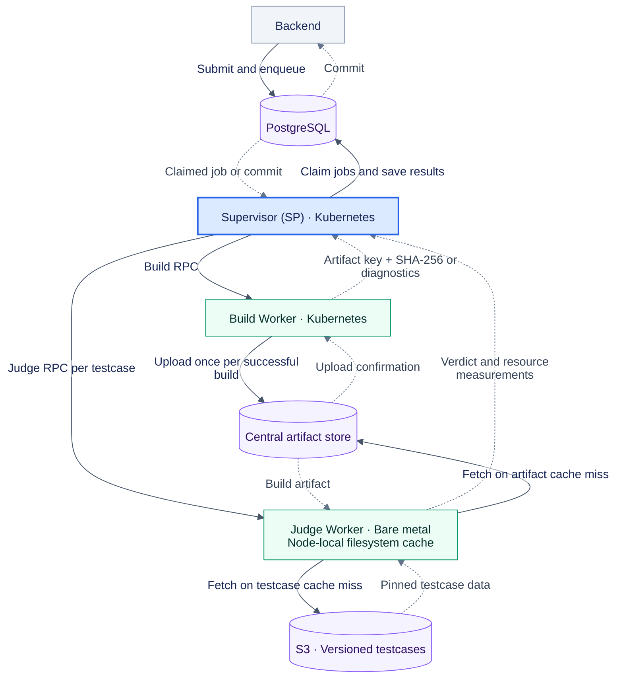

# ADR 0010: Scale Iris build and judge workers independently

## Context

Iris 2.0 needs to sustain throughput and return consistent verdicts for the same submission and testcase. Builds run once per submission on the successful path, while testcase executions grow with the number of cases and can span judge nodes. Compilation and judging can therefore become bottlenecks independently. Separate worker pools let us add build capacity when compilation backs up and add judge capacity when testcase execution backs up. Placing the pools on different nodes also removes compilation on the judge host as a source of interference in measured execution.

Even on a dedicated judge node, concurrent testcases compete for shared resources. The Wave 1 experiment recorded in ADR 0007 observed higher CPU and elapsed times for the same program and input as concurrency increased. Shared caches and memory bandwidth can contribute to that interference even when judging uses CPU time. A submission close to its time limit can receive a different verdict under contention. A conservative fixed concurrency cap can protect reproducibility while leaving capacity idle under lighter workloads. [ADR 0007](./0007-adapt-iris-judge-concurrency.md#context)

The supervisor (SP) uses recent capacity and host pressure measurements to decide where and when to start each testcase. Available slots show how many more executions the worker can admit under its local limit. Scheduler pressure, memory bandwidth where measurable, and cache observations help assess contention in the current workload. The resource demand of the next testcase is unknown, so these observations guide dispatch and workers enforce local concurrency limits. The goal is to increase sustainable throughput and reduce queue wait while keeping execution times and near-limit verdicts reproducible. A fixed-cap baseline gives us a comparison for testing whether metric-informed dispatch achieves that goal.

## Decision drivers

- Scale build throughput and testcase execution capacity independently.
- Build once per submission on the successful path and reuse that output across testcase retries and node reassignments.
- Preserve execution-time and verdict reproducibility under load while using available judge capacity.
- Recover pending work and partial results after a supervisor restart.

## Considered options

| Decision area | Alternatives and trade-offs | Prototype choice |
| --- | --- | --- |
| Work intake | RabbitMQ pushes jobs to consumers and requires coordination between submission persistence and publication. PostgreSQL polling lets intake record the submission and pending job in one transaction, with polling load and pickup latency to measure. | Poll and claim jobs from PostgreSQL. |
| Dispatch granularity | Submission-level dispatch keeps scheduling and aggregation on one worker. Testcase-level dispatch can use spare slots across nodes and retry individual cases, with more RPCs and result tracking. | Dispatch one RPC per testcase. |
| Build placement | Building in the SP couples compile capacity to scheduling. Building on Judge Workers can reuse local output but shares judge host resources and requires a way to distribute outputs across nodes. Separate workers add an RPC and can scale independently. | Run Build Workers in Kubernetes on separate nodes from the Judge Workers. |
| Build artifact delivery | RPC payloads keep the call self-contained but repeat the same bytes for each testcase. A shared filesystem gives workers a common path and requires mount and access management across Kubernetes and bare metal. Central storage adds an upload and a cold fetch and lets nodes reuse the artifact during retries. | Publish once to central storage and fetch by reference into each judge node's filesystem cache. |
| Judge admission | Fixed caps and available slots give a simple baseline but treat workloads with different resource demands alike. Host pressure metrics can reveal contention and support deferring work, with decisions sensitive to measurement freshness. | Use recent host pressure and available slots for dispatch. Enforce local worker limits and compare against a fixed-cap baseline. |
| Supervisor recovery | Active failover can reduce recovery time and requires leader election and ownership handoff. A single active SP can resume from durable state after Kubernetes restarts it, with a pause in dispatch during recovery. | Run one active SP with PostgreSQL-backed recovery. |
| Judge Worker placement | Bare metal provides a dedicated reference environment. Dedicated Kubernetes nodes can integrate workers into the cluster's deployment model, with placement and timing behavior to verify. | Start on bare metal and evaluate Kubernetes node affinity. |

## Decision

The distributed prototype uses PostgreSQL as the durable work queue and source of recovery state. A single active SP in Kubernetes claims submission jobs, requests one build per submission on the successful path, and records testcase results and the final verdict.

Build Workers run in Kubernetes and Judge Workers run on separate bare-metal nodes. The pools scale independently. Build Workers publish one artifact per successful build to central storage. Judge Workers cache that artifact and the pinned S3 testcase data on their local filesystems.

The SP dispatches one RPC per testcase using available slots and recent host pressure. It defers work when capacity is unavailable. Judge Workers enforce local concurrency limits, and the SP aggregates their results across nodes.

Solid arrows show requests and writes. Dashed arrows show responses.

::: details Mermaid source

:::

| Component | Responsibility and placement |
| --- | --- |
| SP | Go service in Kubernetes. Polls and claims jobs, requests builds, collects worker metrics, schedules testcases, and aggregates results. Bounded Go channels queue dispatch work in memory. |
| Build Worker | Kubernetes Pod. Compiles and packages the submission, uploads the artifact, and returns its reference or compiler diagnostics. Go is the planned implementation, with Iris 1.0 build logic available for reuse. |
| Judge Worker | Rust RPC service wrapping libjudger. Starts on bare-metal nodes outside Kubernetes. Reports available slots and host pressure, manages node-local filesystem caches, and judges testcases in processes isolated by cgroups and namespaces. |
| PostgreSQL | Stores pending jobs, claim and processing state, build artifact references, and testcase results. |
| Central artifact store | Holds build artifacts through judging and retries. Build Workers write artifacts and Judge Workers read them. |
| S3 | Holds the versioned testcase originals. Judge Workers fetch them on local cache misses. |

### Request flow

1. The backend records the submission and its pending judge job in one PostgreSQL transaction. The SP polls for work and claims a job in a short transaction. `FOR UPDATE SKIP LOCKED` is one option for the claim.
2. The SP calls a Build Worker over RPC. A compiler error completes the submission with a compile-error verdict. On success, the Build Worker uploads the artifact and returns `artifact_key` and `sha256`. The SP records the reference on the existing job before dispatching testcases.
3. The SP selects a Judge Worker for each testcase using available slots and recent host pressure metrics. It defers dispatch if capacity is unavailable. Each worker enforces its own concurrency limit. Every judge RPC includes the testcase ID, its pinned version and S3 reference, and the build artifact reference.
4. The Judge Worker uses its node-local filesystem caches. On a miss, it fetches the build artifact from the central store or the pinned testcase data from S3. Concurrent requests for the same artifact share one download on each node. The worker verifies the checksum and publishes the completed entry atomically. Testcase cache versioning and publication follow the TC Manager contract. [ADR 0008](./0008-integrate-iris-with-node-local-testcase-cache-manager.md)
5. The Judge Worker executes the testcase and returns its verdict and resource measurements in the RPC response. The SP records each testcase result and aggregates the submission verdict.

### Recovery

Run one active SP with Kubernetes health checks and restarts. On startup, the SP reconciles jobs using PostgreSQL state, reuses recorded artifacts and completed results, and reassigns unfinished testcases when needed. A timed-out RPC can still be running. Reconcile the attempt before freeing its slot or retrying, and use the current attempt identity to reject stale results and handle duplicate responses.

### Judge Worker placement

Use bare-metal Judge Workers for the prototype. Evaluate moving them into Kubernetes with node affinity to target dedicated judge nodes.

## Consequences

- Each worker pool can grow independently as its queue or capacity becomes the bottleneck.
- Artifact upload and cold cache fills add latency before the first testcase starts. Concurrent testcase requests on the same node share that cost.
- The SP coordinates testcase fan-out, retries, and final verdict aggregation. The central store must retain artifacts for the maximum judging and retry window.

## Verification

- Vary build and judge worker counts independently under compile-heavy and judge-heavy workloads. Measure build queue wait, testcase queue wait, time from build completion to first testcase start, and submission throughput.
- Verify one artifact upload per successful build and one download per cold node for concurrent requests. Check that warm requests reuse the node-local cache and that a corrupt download fails verification.
- Check that the SP defers dispatch when no worker has capacity and that workers enforce their local limits. Under the same workloads and worker configuration, compare metric-informed dispatch with dispatch based on fixed worker caps and available slots. Measure throughput, testcase queue wait, CPU and elapsed-time distributions, and near-limit verdict agreement across repeated runs of the same program and input.
- Restart the SP with a partially judged submission and check that it reuses the stored artifact and completed results. Exercise worker failure, RPC timeout, and late or duplicate responses to verify that results and slot accounting remain consistent.
- When evaluating Kubernetes placement, verify that affinity places Judge Workers on dedicated nodes and compare execution times and verdict stability against bare metal.

## Links and change history

- [ADR 0007 — Iris 2.0 execution control proposal](./0007-adapt-iris-judge-concurrency.md)
- [ADR 0008 — Node-local testcase cache manager](./0008-integrate-iris-with-node-local-testcase-cache-manager.md)
- 2026-11-22 — Lee Haesung — Proposed the distributed design to supersede ADR 0007.
